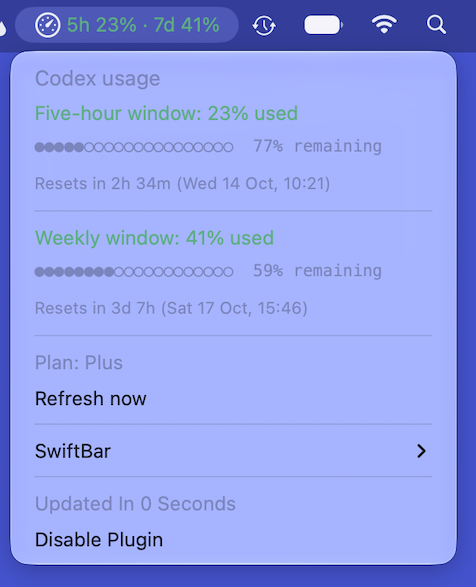

# Codex Usage for SwiftBar

A small Python plugin that shows your Codex five-hour and weekly usage in the macOS menu bar using [SwiftBar](https://swiftbar.app/).



Open the menu to see usage and remaining capacity for each window, progress bars, reset times in your local timezone, and your plan type.

## Features

- Refreshes every minute, or with a **Refresh now** menu item.
- Colours the menu bar indicator according to the higher of the two usage percentages: green below 60%, amber from 60%, and red from 85%.
- Shows both a countdown and a local date and time for each reset.
- Falls back to cached usage when a refresh fails, with an amber menu bar indicator, a warning symbol, and the time of the last successful update.
- Uses only the Python standard library; no Python packages to install.

## Requirements

- macOS with SwiftBar installed.
- Python 3.10 or later, available as `python3` to SwiftBar.
- The Codex CLI installed and signed in to the account you want to monitor.
- A Codex CLI version that supports `app-server` and the `account/rateLimits/read` method, with both primary and secondary usage windows available for your account.

The plugin treats the primary window as five-hour usage and the secondary window as weekly usage. Accounts or CLI versions that return a different structure may need changes to the script.

## Installation

1. Download [codex-usage.1m.py](codex-usage.1m.py).
2. Place it in the plugin folder configured in SwiftBar.
3. Make the file executable. In a terminal opened in that folder, run:

   ```sh
   chmod +x codex-usage.1m.py
   ```

4. Refresh SwiftBar's plugins, or wait for it to detect the file.

Keep the `.1m.py` filename suffix for a one-minute refresh interval.

To check the output manually, run this from the plugin folder:

```sh
python3 codex-usage.1m.py
```

The output includes SwiftBar formatting instructions, which is expected when running it in a terminal.

## Configuration

The plugin searches for the Codex executable in this order:

1. The path specified by the `CODEX_CLI_PATH` environment variable.
2. `codex` on SwiftBar's `PATH`.
3. `~/homebrew/bin/codex`.
4. `/opt/homebrew/bin/codex`.
5. `/usr/local/bin/codex`.
6. `~/.local/bin/codex`.

For a custom installation, make `CODEX_CLI_PATH` available in SwiftBar's environment. Use the full path to the executable, without a literal `~`.

You can test a custom path in a terminal with:

```sh
CODEX_CLI_PATH="/absolute/path/to/codex" python3 codex-usage.1m.py
```

This sets the variable for that command only; it does not configure SwiftBar.

## How it works

On each refresh, the plugin starts a local `codex app-server` process, initializes a connection over standard input and output, and requests the account's rate limits. It then stops the process and formats the result for SwiftBar.

The plugin displays usage reported by Codex. It does not estimate usage from local session files or calculate API spending.

## Privacy and cache

The script contains no account credentials and uses the installed Codex CLI's existing authentication. It adds no separate analytics or upload service; account requests are handled by the Codex CLI.

Successful responses are saved locally at:

```text
~/Library/Caches/SwiftBarCodexUsage/rate-limits.json
```

The cache contains the returned rate-limit data and a save timestamp. If a refresh fails, cached data up to 24 hours old can be displayed. Older data is ignored, but the cache file is not automatically deleted.

Keep the cache out of public repositories. Menu screenshots can reveal usage, plan details, and reset times; error messages may also contain local paths or details returned by the CLI.

## Troubleshooting

| Symptom | What to check |
| --- | --- |
| Plugin does not appear | Confirm the file is in SwiftBar's configured plugin folder, is executable, and that SwiftBar can find `python3`. |
| `Codex CLI not found` | Check the executable locations above, or configure `CODEX_CLI_PATH` in SwiftBar's environment. |
| `Codex ?` in the menu bar | Open the menu for the error message. Check CLI authentication and whether your CLI and account support the expected rate-limit response. |
| Timeout error | Check that Codex can connect successfully, then choose **Refresh now**. |
| Warning symbol beside usage | The latest request failed and cached data is being shown. Open the menu to see when it was saved. |
| Works in Terminal but not SwiftBar | Check SwiftBar's environment: its `PATH` and other variables may differ from your terminal's. |

## Contributing

Bug reports and improvements are welcome. See [CONTRIBUTING.md](CONTRIBUTING.md) for reporting and development guidance, and [SECURITY.md](SECURITY.md) for security reports.

Changes are recorded in [CHANGELOG.md](CHANGELOG.md).

The repository includes syntax checks for both GitHub Actions and GitLab CI, so the same files can be published on either platform. GitLab CI targets GitLab.com's shared Linux runners using the `saas-linux-small-amd64` tag; enable instance runners for the GitLab project. These checks do not require Codex credentials.

## Licence

This project is licensed under the [MIT licence](LICENSE).

This is an independent community plugin and is not affiliated with OpenAI or SwiftBar.
